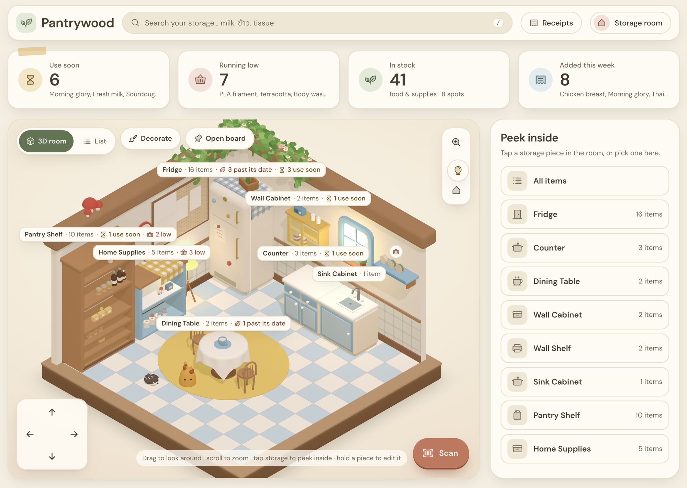

# Pantrywood

A cozy, cottagecore front end for a self-hosted [Grocy](https://grocy.info). Your storage room becomes a little 3D
retro kitchen diorama: the fridge, counters, shelves, cabinets and table are your real Grocy locations, filled with
your real stock, both food and everyday things like tissue, shampoo and 3D-printer filament.



## What it does

- **A 3D storage room.** Every Grocy location is a piece of furniture with a tag showing how many items it holds,
  what's past its date, what to use soon and what's running low. Tap a piece to peek inside.
- **Inside views.** Open the fridge in live 3D (main shelves, freezer and door bins) or any shelf or cabinet, and
  arrange items on their shelves by dragging, or with buttons.
- **Time of day.** The room's light follows your clock: bright by day, golden in the late afternoon, and lamp-lit in
  the evening. A light switch on the wall turns the room dark and moonlit at night.
- **Decorate.** Move, rotate and hang the furniture and decor, keep pieces plain or dressed up with their props, and
  add storage spots, which become new Grocy locations.
- **Scan.** Use the camera or a USB barcode scanner to add, use and move stock, with Undo.
- **Receipts.** Photograph a receipt and its lines are read on your device and matched to your products.
- **Pegboard.** Pin notes to a board on the wall, linked to products so they tick off when you restock.

Grocy stays the source of truth for products and stock. Pantrywood's own data (the room layout, shelf
arrangements and pegboard) lives in your browser for now.

## Getting started

You need Node.js and [pnpm](https://pnpm.io).

```bash
pnpm install
cp apps/web/.env.example apps/web/.env.local
pnpm dev
```

Then open <http://localhost:3000>.

- **No Grocy at hand?** Leave `MOCK_GROCY=true` in `apps/web/.env.local`. The app runs against an in-memory sample
  Grocy that resets every time the server restarts.
- **Your own Grocy:** set `MOCK_GROCY=false`, `GROCY_URL` (without `/api`) and `GROCY_API_KEY` (Grocy → Manage API
  keys). The key stays on the server: the browser only talks to Pantrywood's own proxy.

Locations are matched to furniture by name. For example, "Fridge", "Counter", "Sink cabinet", "Pantry shelf",
"Wall cabinet", "Wall shelf", "Home supplies" and "Dining table" each get their own piece; anything else becomes a
wicker basket.

## Commands

Run from the repo root:

| Command | What it does |
| --- | --- |
| `pnpm dev` | Start the app in development |
| `pnpm build` | Production build |
| `pnpm typecheck` | Type-check every package |
| `pnpm lint` | Lint every package |
| `pnpm test` | Run the tests (Node's built-in test runner) |

## Built with

Next.js, React Three Fiber and drei for the 3D scenes, TanStack Query, Zustand, zod, @dnd-kit, Tailwind CSS and
Motion, in a Turborepo monorepo. Receipts are read on the device with PaddleOCR models running in onnxruntime-web.

## Project layout

- `apps/web`: the Next.js app, including the Grocy proxy (`app/api/grocy`) and the in-memory mock Grocy
- `packages/shared`: schemas and types shared between packages
- `docs`: the design guide, product notes, mockups and screenshots
